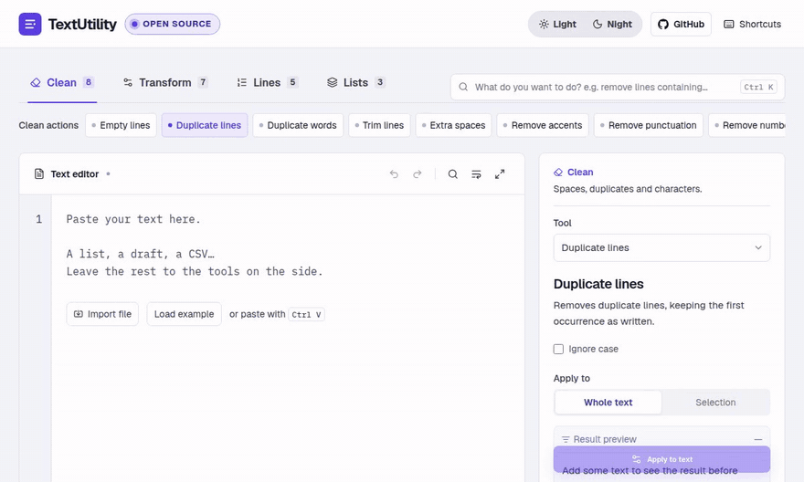

# TextUtility



A batch text editor that runs entirely in your browser. Clean, transform, sort, filter and compare lists of text without sending anything to a server.

Link: https://textutilities.tech

## Features

- **23 tools** in four categories: clean, transform, lines and lists.
- **Task search** (`Ctrl+K`): type what you want to do, for example "remove lines containing", and jump to the right tool.
- **Result preview** before anything is applied, on the whole text or on the current selection.
- **Undo, redo and restore** for the ten most recent edits.
- **Find and replace** with regular expression and case options.
- **Import** `.txt` and `.csv` files (UTF-8), **copy** or **download** the result.
- No account, no API, no database. Nothing to configure.

## Tools

| Category | Tools |
| --- | --- |
| Clean | Empty lines, Duplicate lines, Duplicate words, Trim lines, Extra spaces, Remove accents, Remove punctuation, Remove numbers |
| Transform | Uppercase, Lowercase, Title case, Sentence case, Reverse text, Prefix and suffix, Number lines |
| Lines | Sort lines, Remove or keep lines, Split by delimiter, Join lines, Extract column |
| Lists | Compare lists (intersection, difference, union), Merge lists, Random sample |

"Remove or keep lines" filters by lines that contain a term, start or end with it, or match it exactly. It also accepts a regular expression.

## Getting started

Requires Node.js 22 or newer and npm.

```bash
npm ci
npm run dev
```

Then open <http://localhost:3000>.

| Script | What it does |
| --- | --- |
| `npm run dev` | Start the development server |
| `npm run build` | Build a static export into `out/` |
| `npm test` | Run the unit tests |
| `npm run typecheck` | Type-check the project |

## Privacy

Transformations and file imports run on the client. Your text is never sent to a server.

- The current draft is kept in this browser's `localStorage`.
- The light or night mode choice is kept in the same browser.
- The edit history (up to ten edits) lives only in the session and is not saved.
- The stylesheet loads Geist and IBM Plex Mono from Google Fonts, which can cause a request to Google. Your text is not part of that request.

## Limits

- Imported files are limited to 4 MB. Processed text is limited to 2 million UTF-16 code units.
- Regular expressions follow JavaScript syntax.
- Find and replace is literal: `$1` and similar group references are not expanded.
- CSV is treated as delimited text. Column extraction does not parse quoted fields or multiline fields.

## Project structure

```
app/                Next.js App Router entry: layout, page, global styles
components/
  workspace.tsx     The editor UI
lib/
  operations.ts     Tool catalog and pure text operations
  discovery.ts      Task search over the catalog
  editor.ts         Find, replace and selection helpers
  history.ts        Undo and restore history
tests/              Unit tests (node:test, run with tsx)
```

## Contributing

Contributions are welcome. New operations belong in `lib/operations.ts` with tests in `tests/`. Before opening a pull request, run `npm test`, `npm run typecheck` and `npm run build`.

## License

[MIT](LICENSE)
